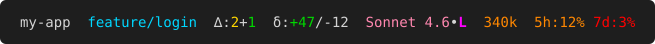

# agent-statusline

Status lines and status-bar configurations for the CLI agent harnesses on macOS:
**Qoder CLI**, **Claude Code**, **Codex CLI**, and **Antigravity CLI**.

This repository is the single source of truth so that CLI updates, reinstalls,
or settings resets never wipe out custom status lines or their config bindings.
`./sync.sh push` deploys the scripts and restores the status-line bindings in
each harness's runtime configuration.

## Overview of Harnesses

| Harness | Component | Repo Artifact | Runtime Script | Config Binding Managed by `sync.sh` |
| --- | --- | --- | --- | --- |
| **Qoder CLI** (`qoderclicn`) | `qoder` | [`qoder/statusline-command.sh`](qoder/statusline-command.sh) | `~/.qoder-cn/statusline-command.sh` | `~/.qoder-cn/settings.json` → `.statusLine` |
| **Claude Code** (`claude`) | `claude` | [`claude/statusline.sh`](claude/statusline.sh) | `~/.claude/statusline.sh` | `~/.claude/settings.json` → `.statusLine` |
| **Codex CLI** (`codex`) | `codex` | [`codex/statusline.toml`](codex/statusline.toml) | — (built-in TUI widgets) | `~/.codex/config.toml` → `[tui]` (`status_line`, `status_line_use_colors`) |
| **Antigravity CLI** (`agy`) | — | — | — | Built-in TUI footer only (no external `statusLine` command or widget array setting) |

---

## 1. Qoder CLI (`qoder`)

One POSIX `sh` script ([`qoder/statusline-command.sh`](qoder/statusline-command.sh)),
no dependencies beyond `jq` and `git`. Renders a single compact line:

```
❯ Qwen3.8-Max 400k | ctx 11% | cr 76% | AG 2 | +12/-3 | main | ~/dev/project
```

### Segments

| Segment | Source | Notes |
| --- | --- | --- |
| `❯` | — | Light-gray left-edge marker (chevron, `38;5;250`), keeps the model name off the terminal edge. |
| Model | `model.display_name` | Followed by the context window limit in compact form (`4k`, `400k`, `1M`). |
| `ctx` | `context_window.used_percentage` | Percentage of the context window currently used. Green up to 50%, yellow up to 80%, red above. Falls back to `100 - remaining_percentage`. |
| `cr` | `credits.user_quota` | Percentage of the plan credit pool still remaining for the current billing period (`remaining / total`, clamped to 0–100). Green from 50%, yellow from 20%, red below. Hidden when no snapshot is available. |
| `AG N` | session transcript + subagent registry | Live subagent count: the max of `Agent` tool calls without a result yet (with an incremental byte-offset cache) and non-terminal `subagents/task-*.json` entries. Shown only while > 0. |
| `+N/-M` | `git diff` | Working tree changes, including untracked files. Hidden when clean. |
| Branch | `git` | Cyan on `main`, bright magenta on any other branch, yellow `no commits` in a commit-less repo, bold red `NO GIT!` outside a repository. |
| Path | `workspace.current_dir` | `$HOME` shortened to `~`. |

---

## 2. Claude Code (`claude`)

A semantic, four-layer 256-color Bash status line ([`claude/statusline.sh`](claude/statusline.sh)):
git working-tree state, context-window token budget against the resolved
auto-compact window, 5-hour and 7-day rate-limit traffic lights, per-family
model coloring, and a bold-magenta flag whenever reasoning effort is outside
the safe set.



### Color Layers (One Color, One Meaning)

| Layer | Color | Meaning | Appears on |
| --- | --- | --- | --- |
| **Traffic Light** | orange (`38;5;208`) | approaching a ceiling (warn) | context tokens (`NNNk`), rate limits (`5h`, `7d`) |
| **Traffic Light** | red (`38;5;196`) | at the ceiling (critical) | context tokens (`NNNk`), rate limits (`5h`, `7d`) |
| **Attention** | bold magenta (`1;38;5;201`) | run configured off the safe default | `•eff` outside `STATUSLINE_SAFE_EFFORT` |
| **Identity** | purple (`38;5;135`), pink (`38;5;211`), turquoise (`38;5;43`), sky blue (`38;5;75`) | active model family (Opus, Sonnet, Fable, Haiku) | `model` |
| **Information** | cyan (`38;5;45`), yellow (`38;5;220`), green (`38;5;40`), default | off-main branch, modified tracked files, added files/lines, neutral text | `branch`, `∆:C+N`, `δ:+A/-D`, `dir` |

### Segments

| Segment | Shows | Coloring |
| --- | --- | --- |
| `dir` | current directory basename | default |
| `branch` | current git branch | cyan when not `STATUSLINE_MAIN_BRANCH` (`main`) |
| `∆:C+N` | uncommitted files: `C` changed (tracked), `N` new (untracked) | `C` yellow when > 0, `N` green when > 0 |
| `δ:+A/-D` | uncommitted line diff of tracked files vs `HEAD` | `+A` green when > 0, `-D` default |
| `model` | active model (`display_name` with ` context)` shortened to `)`) | Opus purple, Sonnet pink, Fable turquoise, Haiku sky blue; other models default |
| `•eff` | reasoning effort glued to the model (`L`, `M`, `H`, `XH`, `X`) | bold magenta when not in `STATUSLINE_SAFE_EFFORT` |
| `NNNk` | input-side context tokens (`input + cache_creation + cache_read`, fallback `used_percentage * context_window_size`) | orange from `STATUSLINE_CTX_WARN_PCT` (60%), red from `STATUSLINE_CTX_CRIT_PCT` (80%) of the auto-compact window |
| `5h:X%` / `7d:Y%` | share of the 5-hour / 7-day rate limit left (`100 - used`) | orange below `STATUSLINE_RL_WARN_LEFT` (20%), red below `STATUSLINE_RL_CRIT_LEFT` (5%) |

### Environment Variables

| Variable | Default in Script | Live Binding in `~/.claude/settings.json` | Meaning |
| --- | --- | --- | --- |
| `STATUSLINE_CTX_WARN_PCT` | `60` | `60` | % of the auto-compact window from which `NNNk` turns orange |
| `STATUSLINE_CTX_CRIT_PCT` | `80` | `80` | % of the auto-compact window from which `NNNk` turns red |
| `STATUSLINE_CTX_WINDOW` | auto-detected | auto-detected | override auto-compact window in tokens (`CLAUDE_CODE_AUTO_COMPACT_WINDOW` → user/project/local/managed `settings.json` → `context_window_size`) |
| `STATUSLINE_RL_WARN_LEFT` | `20` | `20` | rate-limit % left below which `5h`/`7d` turns orange |
| `STATUSLINE_RL_CRIT_LEFT` | `5` | `5` | rate-limit % left below which `5h`/`7d` turns red |
| `STATUSLINE_SAFE_EFFORT` | `high xhigh` | `medium high xhigh` | space-separated effort levels (full names) not flagged in bold magenta |
| `STATUSLINE_MAIN_BRANCH` | `main` | `main` | home branch name shown without cyan highlight |
| `NO_COLOR` | unset | unset | set to any non-empty value to disable all ANSI colors |

---

## 3. Codex CLI (`codex`)

Codex CLI renders its status bar from built-in TUI widgets configured under
`[tui]` in `~/.codex/config.toml`. Because `~/.codex/config.toml` also holds
MCP server credentials and project trust tables, this repository versions only
the status-line slice in [`codex/statusline.toml`](codex/statusline.toml):

```toml
[tui]
status_line = ["run-state", "model-with-reasoning", "current-dir", "git-branch", "context-used", "weekly-limit", "fast-mode"]
status_line_use_colors = true
```

`./sync.sh` checks and updates only `status_line` and `status_line_use_colors`
inside `[tui]` of `~/.codex/config.toml`, leaving all other keys, sections, and
comments untouched.

---

## 4. Antigravity CLI (`agy`)

Antigravity CLI uses a built-in TUI status bar (workspace, branch, model,
token/context usage, input mode) and does not expose a custom `statusLine`
shell hook or configurable widget array (its `~/.gemini/antigravity-cli/settings.json`
is also protected by Antigravity's system boundary). No external status-line
artifact is required for `agy`.

---

## Sync & Installation

Check sync status across all harnesses (or pass specific component names
`qoder`, `claude`, `codex`):

```sh
./sync.sh status
```

Deploy scripts and restore config bindings (`~/.qoder-cn/settings.json`,
`~/.claude/settings.json`, `~/.codex/config.toml`):

```sh
./sync.sh push
```

Adopt an intentional runtime edit back into the repository (requires explicit
confirmation per component):

```sh
./sync.sh pull --confirmed qoder
./sync.sh pull --confirmed claude
./sync.sh pull --confirmed codex
```

## Harness & Contract-First Workflow

The repository is the source of truth for every component; runtime copies and
config bindings are kept in sync by `./sync.sh`. Changes follow a
contract-first cycle: each component has a permanent specification contract and
provenance journal in [`contracts/`](contracts/AGENTS.md):

- Qoder CLI: [`contracts/qoder.md`](contracts/qoder.md) and [`contracts/qoder-journal.md`](contracts/qoder-journal.md)
- Claude Code: [`contracts/claude.md`](contracts/claude.md) and [`contracts/claude-journal.md`](contracts/claude-journal.md)
- Codex CLI: [`contracts/codex.md`](contracts/codex.md) and [`contracts/codex-journal.md`](contracts/codex-journal.md)

Research artifacts live in `analysis/`. A pre-push hook (`.hooks/`, activate
with `git config core.hooksPath .hooks`) blocks pushes on repo↔runtime drift,
contract/index/link violations, or render failures. The harness is an
adaptation of the `~/dev/agent-skills` harness, kept aligned by a hash pin and
periodic check (`./harness-check.sh`). Policy: [`AGENTS.md`](AGENTS.md).

## License

[MIT](LICENSE)
